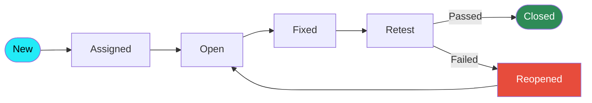

<div align="center">


<br/><br/>


</div>

---

## 🐞 BUG-001: "Team is missing a detail-oriented QA intern"

> A recruiter-friendly bug report, because a tester should introduce herself like one.

| Field | Details |
|---|---|
| **Bug ID** | BUG-001 |
| **Summary** | Your QA team does not have Rashi Panchal yet |
| **Severity** | 🔴 High |
| **Priority** | P1 (fix this week) |
| **Status** | 🟡 Open, ready to be assigned |
| **Environment** | Delhi, India • Hybrid / Remote / On-site |
| **Steps to Reproduce** | 1. Open this profile → 2. Read the projects → 3. Connect with me |
| **Expected Result** | We schedule an interview 🤝 |
| **Actual Result** | Waiting for your message 📬 |
| **Assigned To** | `You` |
| **Fix Version** | Starts as soon as possible |

---

## 👩‍💻 About Me

```text
Name        : Rashi Panchal
Education   : BCA (IGNOU), in progress
Focus       : Manual Testing & Software Quality Assurance
Background  : Internships in Java development and frontend development
Superpower  : Seeing the developer's blind spots (that's a feature, not a bug)
Looking for : A QA internship where I can learn fast and add value from day one
```

My development background means I understand how code is built, which helps me guess where it might break.

---

## 🧪 Test Execution Report: My Skills

| # | Test Case | Expected | Status |
|---|-----------|----------|--------|
| TC-01 | Test scenarios & test case design | Clear, reusable cases | ✅ Pass |
| TC-02 | Positive & negative testing | Edge cases covered | ✅ Pass |
| TC-03 | Functional testing | Features match requirements | ✅ Pass |
| TC-04 | Smoke & sanity testing | Quick build verification | ✅ Pass |
| TC-05 | Retesting & regression testing | Fixes verified, nothing broken | ✅ Pass |
| TC-06 | Bug reporting & defect life cycle | Reproducible, clear reports | ✅ Pass |
| TC-07 | Severity vs priority | Correct classification | ✅ Pass |
| TC-08 | SDLC, STLC, Agile & Scrum | Process understood | ✅ Pass |
| TC-09 | SQL & database validation | Data verified with queries | ✅ Pass (basic) |
| TC-10 | API testing with Postman | Requests and responses validated | 🟡 In progress |
| TC-11 | Automation testing | Fundamentals learned | 🔵 Planned |

---

## 🔄 Bug Life Cycle I Follow



---

## 🚀 QA Practice Projects

<table>
<tr>
<td width="50%" valign="top">

### 🔐 Login & Registration Testing
**Focus:** Manual test case design and functional validation

- Wrote positive and negative test cases
- Covered valid and invalid credentials, empty fields, and input validation
- Defined expected and actual results
- Tracked test status and logged defects

`Test Cases` `Functional Testing` `Defect Reporting`

</td>
<td width="50%" valign="top">

### 🛒 E-Commerce Application Testing
**Focus:** Common e-commerce workflows

- Identified scenarios for product browsing and the shopping cart
- Designed positive and negative cases
- Validated expected application behaviour
- Applied functional and regression testing concepts

`Test Scenarios` `Regression` `Workflow Testing`

</td>
</tr>
</table>

---

## 🛠️ Toolbox

<div align="center">

**Testing & QA**


**Dev Background**


</div>

---

## 📈 Learning Roadmap

```text
Manual Testing & Test Design   ██████████░░  Strong
Bug Reporting & Life Cycle     ██████████░░  Strong
SQL & DB Validation            ████████░░░░  Good
Jira                           ███████░░░░░  Growing
API Testing (Postman)          ██████░░░░░░  Growing
Automation Fundamentals        ███░░░░░░░░░  Just started
```

**Next up:** Selenium basics • API test automation • Test management tools

---

## 📊 GitHub Activity

<div align="center">


</div>

<!--
SNAKE ANIMATION (optional): after adding the snake workflow file, remove these comment markers.

<div align="center">
<picture>
  <source media="(prefers-color-scheme: dark)" srcset="https://raw.githubusercontent.com/rashi1m/rashi1m/output/github-snake-dark.svg" />
  
</picture>
</div>
-->

---

## 🤝 Let's Connect

<div align="center">

**Hiring for a QA intern? Let's talk. I'm happy to do a test task or mock bug-hunt.**

<a href="https://www.linkedin.com/in/rashi-panchal-b90b27267/">
  
</a>
<a href="mailto:rashipanchal2003@gmail.com">
  
</a>

<br/><br/>

`Test Status: READY FOR DEPLOYMENT ✅`


</div>

